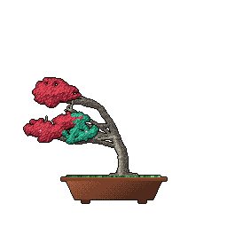
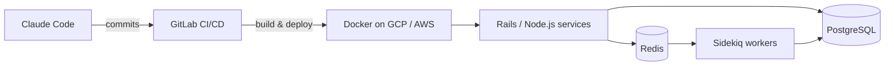

# Akhileshwar Reddy

**Backend engineer · Bangalore, India** 
6+ years building Ruby on Rails services for logistics and HR/benefits SaaS

### The stack I work in

### Companies

   Easyship &emsp;&emsp;
   RootQuotient &emsp;&emsp;
   PlanSource &emsp;&emsp;
   MountBlue &emsp;&emsp;
   Snovasys

