<h3 align="center">Ports of call</h3>

   Easyship &emsp;
   RootQuotient &emsp;
   PlanSource &emsp;
   MountBlue &emsp;
   Snovasys

   
  <i>Grown from my commit history and re-rendered every night by <a href="https://github.com/egorthinks/git-bonsai">git-bonsai</a>.</i>

  <a href="https://www.linkedin.com/in/akhileshwarreddy">LinkedIn</a> &ensp;·&ensp; <a href="mailto:akhilesh.ankireddy@gmail.com">akhilesh.ankireddy@gmail.com</a>

