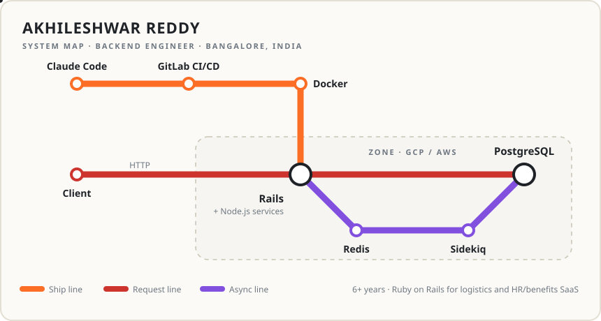

<picture>
  <source media="(prefers-color-scheme: dark)" srcset="assets/metro-dark.svg">
  
</picture>

**Akhileshwar Reddy** · backend engineer · Bangalore, India 
6+ years building Ruby on Rails services for logistics and HR/benefits SaaS.

   Easyship &emsp;
   RootQuotient &emsp;
   PlanSource &emsp;
   MountBlue &emsp;
   Snovasys

[LinkedIn](https://www.linkedin.com/in/akhileshwarreddy) &ensp;·&ensp; [akhilesh.ankireddy@gmail.com](mailto:akhilesh.ankireddy@gmail.com)

 
