#### Companies

   Easyship &emsp;
   RootQuotient &emsp;
   PlanSource &emsp;
   MountBlue &emsp;
   Snovasys

#### Contact

[LinkedIn](https://www.linkedin.com/in/akhileshwarreddy) &ensp;·&ensp; [akhilesh.ankireddy@gmail.com](mailto:akhilesh.ankireddy@gmail.com)

The tree on the right grows from my commit history and is re-rendered every night by [git-bonsai](https://github.com/egorthinks/git-bonsai).

 
