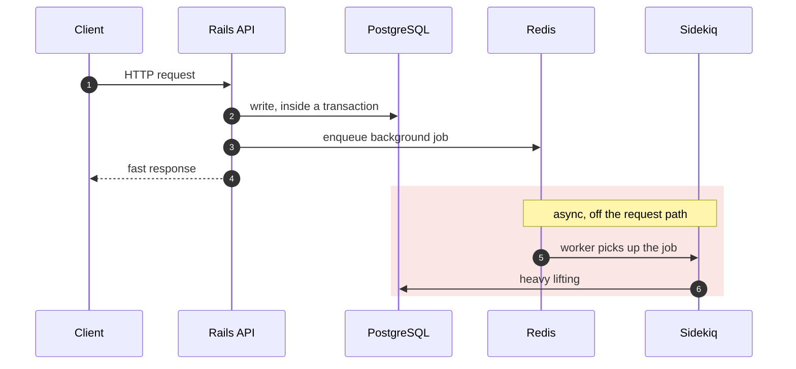
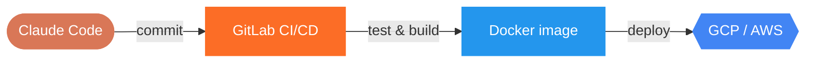

 
<i>grown from my commit history · re-rendered every night</i>

# Akhileshwar Reddy

**Backend engineer** · Bangalore, India · 6+ years 
I build Ruby on Rails services for logistics and HR/benefits SaaS.

<kbd>Ruby</kbd> <kbd>Rails</kbd> <kbd>PostgreSQL</kbd> <kbd>Redis</kbd> <kbd>Sidekiq</kbd> <kbd>Node.js</kbd> 
<kbd>Docker</kbd> <kbd>GCP</kbd> <kbd>AWS</kbd> <kbd>GitLab CI/CD</kbd> <kbd>Claude Code</kbd>

### Life of a request in my stack

### From commit to production

### Places I've built software

   Easyship &emsp;&emsp;
   RootQuotient &emsp;&emsp;
   PlanSource &emsp;&emsp;
   MountBlue &emsp;&emsp;
   Snovasys

About the bonsai

 
The tree at the top is generated by <a href="https://github.com/egorthinks/git-bonsai">git-bonsai</a> from my GitHub history.
Its shape follows account age, total contributions, commit rhythm, streaks and gaps, and a GitHub Action regrows it every night.

